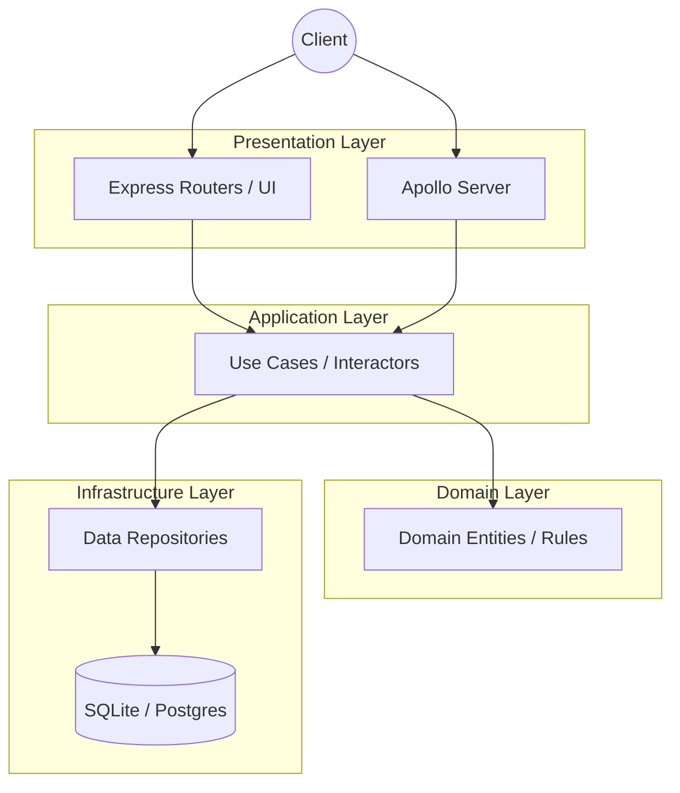

# Cloud-Native GraphQL Gateway


A production-ready, cloud-native API Gateway exposing both RESTful endpoints and a federated GraphQL schema. Engineered with **Clean Architecture** principles, this project demonstrates extreme robustness, observability, and modern design patterns.

---

## 🚀 Built With

- **Backend Architecture:** Express.js, Apollo Server 4, Knex.js
- **Design System:** Tailwind CSS (for the API Dashboard)
- **Validation & Security:** Joi, Helmet, CORS, Express Rate Limit
- **Observability:** Pino (structured logging), Prometheus (metrics)
- **Testing:** Jest, Supertest

---

## 📐 Architecture & Trade-offs

This project strictly adheres to **Clean Architecture** separating concerns into specific layers:



### Why Clean Architecture?
- **Modularity:** UI (Express/Tailwind) and database (Knex) are treated as details. We can swap Express for Fastify without altering business logic.
- **Testability:** Domain logic is isolated, meaning unit tests are fast and don't require database mocking.
- **Trade-offs:** Introduces boilerplate (interfaces, DTOs). In a very small microservice, this might be overkill, but for a gateway designed for scale, it pays off in maintainability.

### The UI Layer
We leverage **Tailwind CSS** directly injected via CDN for the root dashboard (`/`). This avoids complex build steps (like Webpack/Vite) for a service primarily focused on backend API routing, while still providing a modern, sleek interface for developers interacting with the gateway.

---

## 🚦 Quick Start

### 1. Prerequisites
- Node.js >= 18.x
- Docker (optional)

### 2. Installation
```bash
git clone <repo-url>
cd cloud-native-graphql-gateway
npm install
cp .env.example .env
```

### 3. Running the Server

**Development Mode:**
```bash
npm run dev
```

**Production Mode:**
```bash
npm start
```

Navigate to [http://localhost:3000](http://localhost:3000) to see the new Tailwind-powered Dashboard.

### 4. Running via Docker
```bash
docker-compose up --build
```

---

## 🛡️ Robustness & Observability
- **Centralized Error Handling:** All errors are caught by a global Express middleware that sanitizes stack traces and standardizes responses.
- **Metrics Endpoint:** Accessible at `/metrics` for Prometheus scraping.
- **Rate Limiting:** Protects endpoints from DDoS attacks.

## 📝 License
Distributed under the MIT License. See `LICENSE` for more information.
