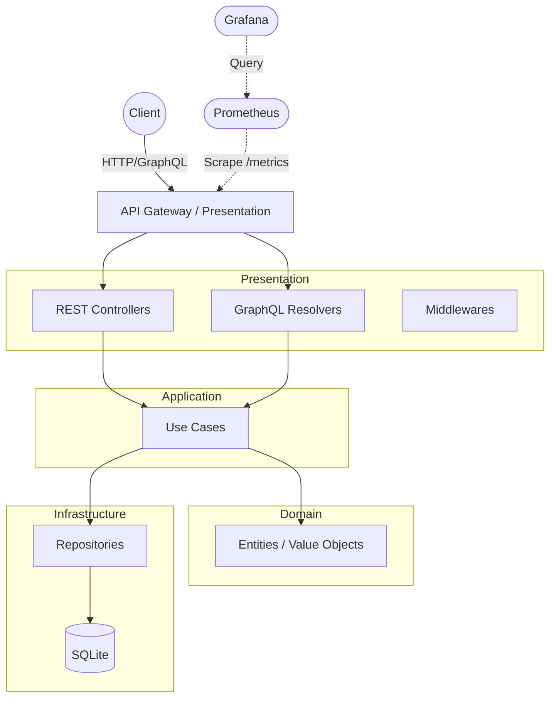

# Cloud-Native RESTful/GraphQL API

## The Why
This is a production-grade API demonstrating Clean Architecture, observability, and cloud-native practices. It serves as a benchmark for building scalable, maintainable, and monitorable backend services using modern Node.js features, Express, Apollo Server, and comprehensive telemetry (Prometheus/Grafana).

## Architecture



## Trade-offs
- **Express vs Fastify**: Express was chosen for its vast ecosystem and mature middleware support, ensuring rapid integration of standard tooling (like GraphQL and rate-limiting).
- **SQLite vs PostgreSQL**: better-sqlite3 was chosen for maximum portability without external database dependencies, while still offering excellent performance for this portfolio project. The repository pattern allows swapping this for Postgres seamlessly in the future.
- **Clean Architecture vs MVC**: Clean Architecture encapsulates the business logic independent of external frameworks, making it easier to test, maintain, and swap out the presentation (REST/GraphQL) or infrastructure (SQLite) layers.

## Quick Start
```bash
# 1. Install dependencies
npm install

# 2. Run the application
npm start

# 3. Access API at http://localhost:3000
#    Access GraphQL at http://localhost:3000/graphql
```

## Running Infrastructure (Metrics & Observability)
```bash
docker-compose up -d
```
Access Grafana at `http://localhost:3001` (admin/admin).

## Testing
- Unit & Integration: `npm test`
- Unit only: `npm run test:unit`
- Integration only: `npm run test:integration`

## API Docs

### Health & Telemetry
- `GET /health` - Liveness probe
- `GET /ready` - Readiness probe
- `GET /metrics` - Prometheus metrics

### REST Endpoints
- `GET /api/users` - List all users
- `POST /api/users` - Create a user
- `GET /api/products` - List products
- `POST /api/products` - Create product
- `GET /api/orders` - List orders
- `POST /api/orders` - Create order

### GraphQL
Endpoint: `POST /graphql`
```graphql
query {
  users {
    id
    email
    name
  }
}
```
