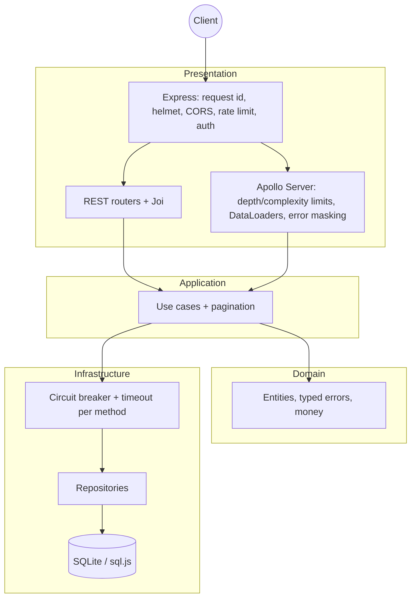

# Cloud-Native GraphQL Gateway


A Node.js service that exposes the same domain (users, products and orders) through a **REST API** and a
**GraphQL API**, organized with Clean Architecture and built to be operated in containers: validated
configuration, API key authentication, GraphQL query limits, DataLoader batching, circuit breakers around data
sources, structured logs with request ids, Prometheus metrics, health/readiness probes and graceful shutdown.

> Scope note: despite the name, the gateway currently fronts a single embedded data source (SQLite via sql.js).
> It is not a federated gateway and does not proxy other HTTP services. The resilience layer (timeouts, circuit
> breakers, stale fallback) wraps the data sources so new upstreams can be added behind the same interface.

## Features

| Area           | What you get                                                                                                                                                              |
| -------------- | ------------------------------------------------------------------------------------------------------------------------------------------------------------------------- |
| APIs           | REST (`/api/users`, `/api/products`, `/api/orders`) and GraphQL (`/graphql`) over the same use cases                                                                      |
| GraphQL safety | Depth limit, cost/complexity limit (aliases included), introspection and landing page off in production, CSRF prevention, no schema suggestions when introspection is off |
| N+1            | Per-request DataLoaders for `Order.user`, `Order.products` and `User.orders`; repositories load order items with one query                                                |
| Resilience     | Opossum circuit breaker + timeout per data-source method; reads fall back to the last good value (`isStale: true`), writes fail fast with 503                             |
| Auth           | API keys (`Authorization: Bearer <key>` or `X-API-Key`), compared in constant time; required by default in production                                                     |
| Abuse control  | Global rate limit, stricter limit for writes (REST POST and GraphQL mutations), optional CPU load shedding, body size limit, server timeouts                              |
| Errors         | Typed domain errors mapped to HTTP status / GraphQL codes; unexpected errors are masked; stack traces never leave the process                                             |
| Observability  | Pino JSON logs with `X-Request-Id` propagation and secret redaction, Prometheus metrics (`/metrics`), `/health` and `/ready` probes                                       |
| Operations     | Config validated at boot, graceful shutdown (drains HTTP + flushes DB), non-root Docker image with HEALTHCHECK, Kubernetes manifests                                      |

## Quick start

Requirements: Node.js 22+ (Docker optional).

```bash
npm ci
cp .env.example .env    # optional; every variable has a default
npm run dev             # http://localhost:3000
```

Without `API_KEYS`, development mode runs **without authentication** (a warning is logged). To try the
authenticated flow locally, set `API_KEYS` in `.env` (generate one with `openssl rand -hex 32`).

```bash
KEY=your-key
curl -H "Authorization: Bearer $KEY" -H 'content-type: application/json' \
  -d '{"name":"Ana","email":"ana@example.com"}' http://localhost:3000/api/users

curl -H "Authorization: Bearer $KEY" -H 'content-type: application/json' \
  -d '{"query":"{ users { id name orders { totalAmount products { name price } } } }"}' \
  http://localhost:3000/graphql
```

| URL         | Description                                               |
| ----------- | --------------------------------------------------------- |
| `/`         | Landing page with links                                   |
| `/graphql`  | GraphQL endpoint (Apollo Sandbox in development)          |
| `/api-docs` | Swagger UI for the REST API (`/swagger.json` raw)         |
| `/health`   | Liveness probe                                            |
| `/ready`    | Readiness probe (checks the database, 503 while draining) |
| `/metrics`  | Prometheus metrics (keep it internal)                     |

### Docker

```bash
cp .env.example .env    # set API_KEYS and GRAFANA_ADMIN_PASSWORD
docker compose up --build
```

This starts the API on port 3000 (production mode, data in the `api-data` volume), Prometheus on 9090 and
Grafana on 3001.

## Configuration

All variables are validated at boot; the process exits with a clear message if any is invalid.

| Variable                   | Default                                       | Description                                                     |
| -------------------------- | --------------------------------------------- | --------------------------------------------------------------- |
| `NODE_ENV`                 | `development`                                 | `development`, `production` or `test`                           |
| `HOST` / `PORT`            | `0.0.0.0` / `3000`                            | Listen address                                                  |
| `LOG_LEVEL`                | `info`                                        | Pino level (`silent` to disable)                                |
| `DB_FILE`                  | `./cloud-native-api.db` (`:memory:` in tests) | SQLite file; `:memory:` for an ephemeral database               |
| `API_KEYS`                 | empty                                         | Comma-separated keys (min. 16 chars). Required when auth is on  |
| `AUTH_ENABLED`             | `true` in production or when keys are set     | Set `false` to explicitly run without auth                      |
| `GRAPHQL_INTROSPECTION`    | `false` in production, else `true`            | Schema introspection                                            |
| `GRAPHQL_LANDING_PAGE`     | same as introspection                         | Apollo Sandbox at `GET /graphql`                                |
| `GRAPHQL_MAX_DEPTH`        | `7`                                           | Maximum selection depth                                         |
| `GRAPHQL_MAX_COMPLEXITY`   | `1000`                                        | Maximum estimated cost (lists multiply by `limit`, default 10)  |
| `CORS_ORIGINS`             | `*`                                           | Comma-separated allowed origins                                 |
| `TRUST_PROXY`              | `false`                                       | Express `trust proxy` (e.g. `1` behind one ingress)             |
| `BODY_LIMIT`               | `100kb`                                       | JSON body size limit                                            |
| `REQUEST_TIMEOUT_MS`       | `30000`                                       | HTTP server request timeout                                     |
| `SHUTDOWN_TIMEOUT_MS`      | `10000`                                       | Forced exit after this long while draining                      |
| `API_DOCS_ENABLED`         | `true`                                        | Serve `/api-docs` and `/swagger.json`                           |
| `RATE_LIMIT_WINDOW_MS`     | `900000`                                      | Rate limit window (15 min)                                      |
| `RATE_LIMIT_MAX`           | `100`                                         | Requests per IP per window on `/api` and `/graphql` (0 = off)   |
| `RATE_LIMIT_WRITE_MAX`     | `30`                                          | Writes per IP per window (0 = off)                              |
| `LOAD_SHED_THRESHOLD`      | `1`                                           | Return 503 when 1-min load average per CPU exceeds it (0 = off) |
| `UPSTREAM_TIMEOUT_MS`      | `3000`                                        | Circuit breaker timeout per data-source call                    |
| `CIRCUIT_ERROR_THRESHOLD`  | `50`                                          | Failure percentage that opens a circuit                         |
| `CIRCUIT_RESET_MS`         | `10000`                                       | Time before a half-open retry                                   |
| `CIRCUIT_VOLUME_THRESHOLD` | `10`                                          | Minimum calls before a circuit may open                         |
| `STALE_CACHE_SIZE`         | `500`                                         | LRU entries per read method kept for stale fallback             |

## Scripts

| Script                  | Purpose                                    |
| ----------------------- | ------------------------------------------ |
| `npm run dev`           | Start with file watching (loads `.env`)    |
| `npm start`             | Start (loads `.env` if present)            |
| `npm test`              | Unit + integration tests (Jest, Supertest) |
| `npm run test:coverage` | Tests with coverage (80% line threshold)   |
| `npm run lint`          | ESLint                                     |
| `npm run format:check`  | Prettier check (`npm run format` to fix)   |
| `npm run check`         | Lint + format check + tests (used by CI)   |

## Architecture



```
src/
  index.js            # process entry: config, logger, DB, HTTP server, graceful shutdown
  app.js              # createApp(): Express + Apollo wiring (used by tests too)
  config/             # env validation (Joi), logger, Prometheus metrics
  domain/             # entities, typed errors, money helpers (pure, no I/O)
  application/        # use cases, pagination rules
  infrastructure/     # sql.js database, repositories, resilience (opossum), composition root
  presentation/
    http/             # request id, auth, rate limiting, validation, error handler
    rest/             # REST routers, landing page, health/readiness
    graphql/          # schema, resolvers, DataLoaders, limits, error formatting
```

Key decisions:

- **Composition root after the database opens.** Repositories receive the opened database; nothing is
  created at import time, which keeps tests isolated and boot order explicit.
- **Business rules live in the domain.** REST validates shape with Joi, but the entities enforce the rules, so
  GraphQL and REST behave the same.
- **Money is summed in integer cents.** Prices accept at most two decimals; order totals have no floating
  point drift (`0.1 + 0.2` gives `0.3`).
- **Circuit breakers only count infrastructure failures.** "Not found", "conflict" and validation errors never
  open a circuit. Stale fallbacks are keyed by the exact method and arguments, are bounded (LRU), are only used
  for reads and are never used to authorize a write.
- **GraphQL errors are allow-listed.** Typed application errors and GraphQL validation errors are returned;
  everything else becomes `Internal server error`, logged server side with the request id.

## GraphQL

```graphql
query {
  orders(limit: 20) {
    id
    totalAmount
    user {
      name
      email
    }
    products {
      name
      price
    }
  }
}
```

- List fields accept `limit` (1-100, default 50; `User.orders` defaults to 20) and `offset`.
- `productIds` may repeat an id to order several units; `totalAmount` is computed server side.
- Error codes in `extensions.code`: `BAD_USER_INPUT`, `NOT_FOUND`, `CONFLICT`, `UNAUTHENTICATED`,
  `SERVICE_UNAVAILABLE`, `QUERY_TOO_COMPLEX`, `GRAPHQL_VALIDATION_FAILED` (depth limit), `INTERNAL_SERVER_ERROR`.
- The schema is covered by a snapshot test (`tests/unit/__snapshots__`); update it only for intended changes.

## Testing

```bash
npm run check
```

- **Unit:** entities, money, config validation, circuit breaker behaviour, use cases, depth limit, error
  formatting, auth and rate-limit helpers, database persistence, schema contract.
- **Integration (Supertest):** REST flows, auth, request id, validation, 404/409/413/500 shapes, rate limits,
  GraphQL queries/mutations, DataLoader batching, depth and complexity limits, production mode (introspection,
  suggestions and landing page disabled), CSRF prevention.

CI (`.github/workflows/ci.yml`) runs lint, format check, tests with coverage and `npm audit`, then builds the
Docker image and smoke-tests it (auth, a GraphQL mutation, introspection disabled, HEALTHCHECK and graceful
shutdown).

## Deployment

### Docker image

Multi-stage build on `node:22-alpine`, production dependencies only, runs as the non-root `node` user, stores
the database in the `/app/data` volume and declares a `HEALTHCHECK`. `docker build --target test .` runs the
full quality gate inside Docker.

### Kubernetes (`k8s/`)

```bash
kubectl create secret generic cloud-native-graphql-gateway-secrets --from-literal=API_KEYS="$(openssl rand -hex 32)"
kubectl apply -k k8s/
```

The manifests include a ConfigMap, a PersistentVolumeClaim for the database, a Deployment (non-root, read-only
root filesystem, startup/readiness/liveness probes, `preStop` delay) and a Service. The Ingress only exposes
public routes, so `/metrics` and `/ready` stay inside the cluster. Replace the image placeholder
`my-registry/cloud-native-graphql-gateway:2.0.0` with your registry. The `preStop` `sleep` action needs
Kubernetes 1.30 or newer.

## Limitations

- **Single writer.** sql.js keeps the database in memory and writes the whole file to disk after each write.
  This works well for small datasets and one replica (the Deployment uses `replicas: 1` with `Recreate`), but it
  is not a substitute for a server database. Running several replicas requires moving to PostgreSQL or similar
  first.
- **In-memory rate limits.** Counters are per process; use a shared store (for example Redis) when scaling out.
- **Synchronous data source.** Because sql.js runs synchronously, the circuit breaker timeout cannot interrupt
  a long query; it is fully effective for asynchronous upstreams.
- **API keys are static.** There is no user login, scopes or key rotation endpoint; rotate keys by updating
  `API_KEYS` and restarting.
- The Apollo Sandbox landing page loads its UI from Apollo's CDN, so it needs internet access in the browser.

## License

Distributed under the MIT License. See [LICENSE](LICENSE).
